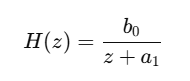
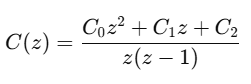
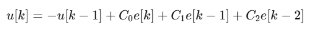

# Levitator Controllers

This repository presents the implementation of several control strategies for a **pneumatic levitation system**, developed as part of the course **Control Systems IV**.

The project focuses on the design, implementation, and comparison of classical and advanced controllers using both **Arduino** and **LabVIEW**, combining embedded programming and graphical control design.

The implemented control approaches include:
- PID controllers (Type 1 and Type 2)
- Generalized polynomial controllers
- State-space controllers
- Fuzzy logic controllers
- Neural network–based controllers

---

## Project Overview

The main objective of this project is to control the vertical position of a pneumatic levitator and evaluate the system behavior under different control techniques. Each controller was tested to analyze stability, response time, and overall performance.

Two development environments were used:
- **Arduino IDE** for embedded control implementation
- **LabVIEW** for graphical control design and analysis

---

## Project Objectives

- Design controllers for a pneumatic levitation system  
- Implement classical and advanced control techniques  
- Compare controller performance in real-time experiments  
- Integrate sensors and actuators using Arduino and LabVIEW  

---

## Technologies Used

- **Arduino UNO / Arduino Mega**
- **C++ (Arduino IDE)**
- **LabVIEW**
- **Sensor:** Proximity sensor
- **Actuator:** 12 V DC motor
- **Control techniques:** PID, polynomial control, state-space, fuzzy logic, neural networks

---
---

## PID Type 1 Controller — Design and Implementation (Arduino)

This section describes the development of the **Type 1 PID controller**
implemented in `Algoritmo1.ino`, based on the methodology presented in
the project report.

### Estimated plant model

The pneumatic levitation system is approximated by a first-order
discrete-time transfer function:

The parameters of the model are estimated online, allowing the controller
to adapt to changes in system dynamics.

### PID Type 1 controller structure

The controller includes integral action and is defined by the following
discrete transfer function:

### Pole placement approach

The controller gains are obtained using a pole placement method.
A desired closed-loop polynomial of the form (z + α)³ is selected,
where the parameter α is tuned experimentally to balance stability and
response speed.

### Discrete control law

The final control signal applied to the actuator is computed using the
following difference equation:

This equation is implemented directly on the Arduino and executed at a
fixed sampling time.

---

## Repository Structure

## Repository Structure

### `controladores-arduino/`
Arduino-based controller implementations:

- `Algoritmo1.ino` – Type 1 PID controller  
- `Algoritmo2.ino` – Type 2 PID controller  
- `Algoritmo4.ino` – Generalized polynomial controller without integral action  
- `Algoritmo5.ino` – Generalized polynomial controller with feedforward gain  
- `1Entrada_9Reglas.ino` – Fuzzy logic controller (1 input, 9 rules)  
- `2Entradas_9Reglas.ino` – Fuzzy logic controller (2 inputs, 9 rules)  
- `2Entradas_25Reglas.ino` – Fuzzy logic controller (2 inputs, 25 rules)  

---

### `controladores-Labview/`
LabVIEW-based controller implementations:

- `Algoritmo_3.vi` – Generalized polynomial controller with integral action  
- `Algoritmo_6.vi` – Reduced state-space controller with feedforward gain  
- `Algoritmo_7.vi` – Reduced state-space controller with integral action  
- `Algoritmo_8.vi` – Extended state-space controller with feedforward gain  
- `Algoritmo_9.vi` – Extended state-space controller with integral action  
- `README.md` – Description of the controllers designed for the pneumatic levitator  

---

## Demonstration Video

Watch the system in operation:  
[Click here to watch the video](https://youtu.be/dqrvql4zS70?si=Z20IAbmv8brBYKhx)

---

## Authors

- **Juan Carlos Aguirre Arenas**  
- **Matthew Ocampo Herrera**

*Mechatronics Engineering*  
*Universidad Tecnológica de Pereira*

